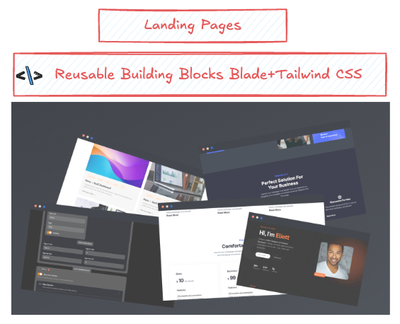
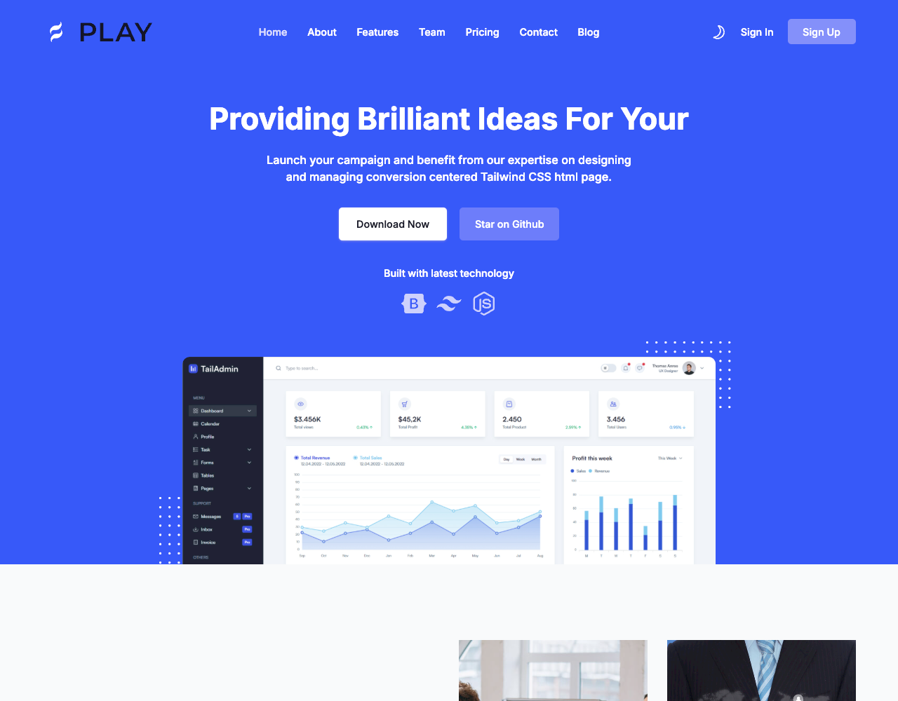
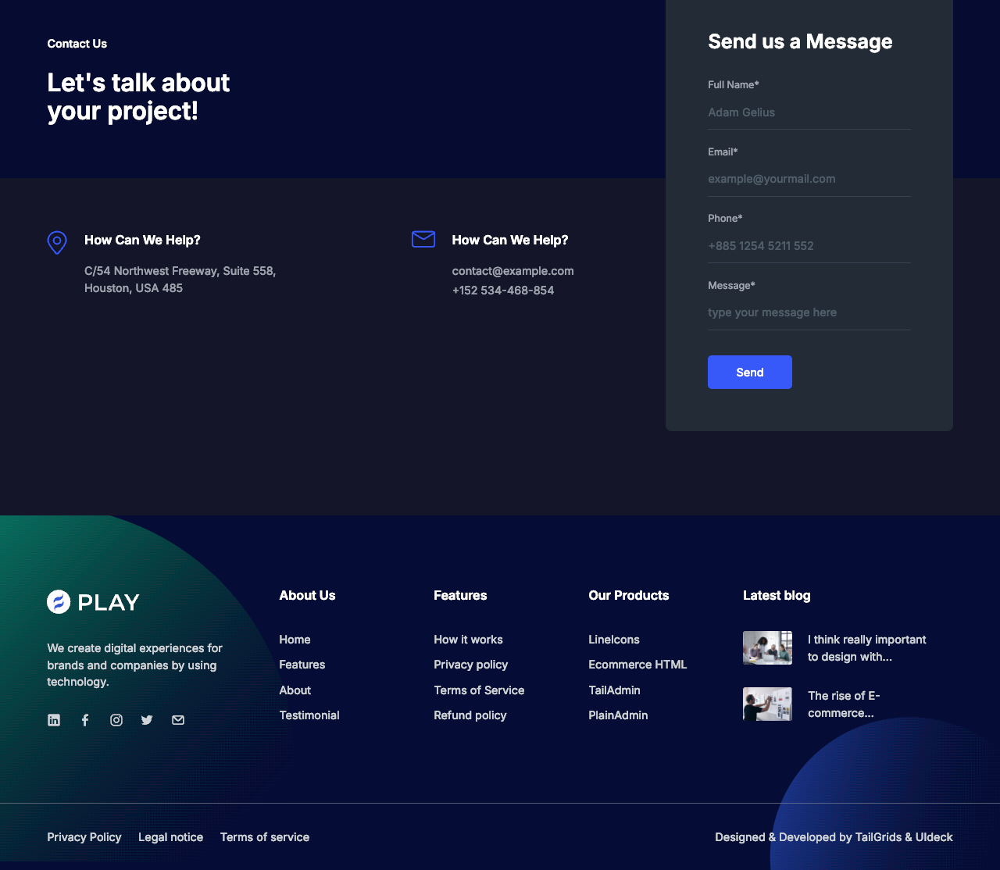
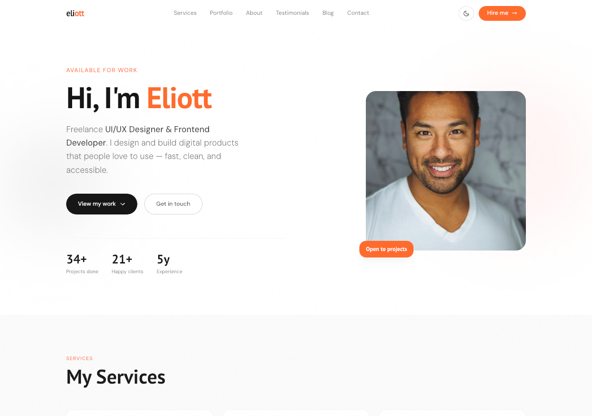
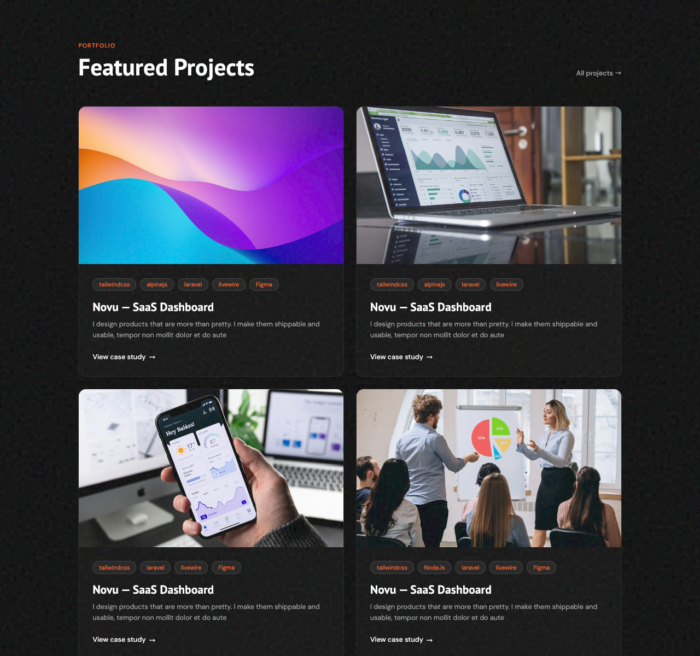
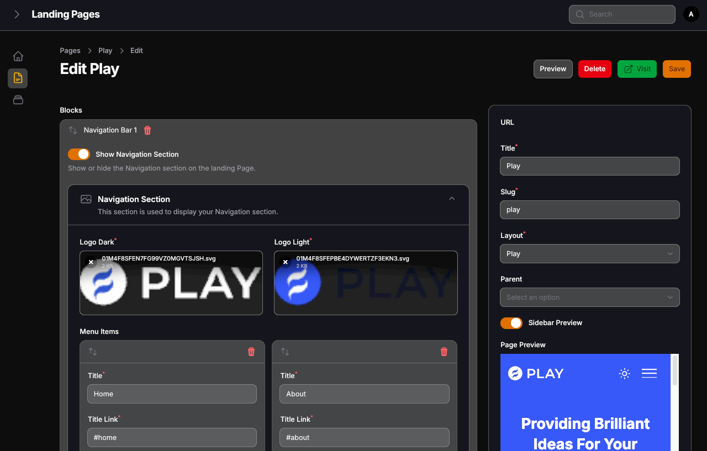
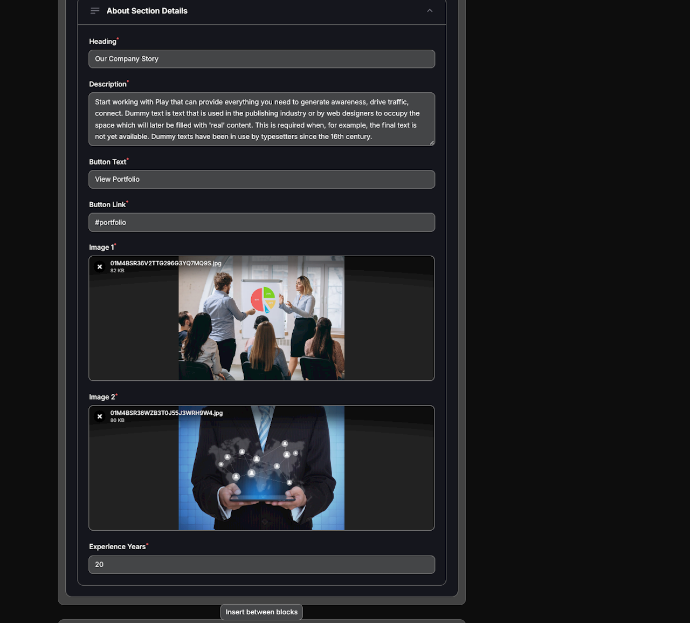

# LandingPages

Dynamic landing page builder with Filament Fabricator - SaaS-ready starter kit

[](https://laravel.com)
[](https://filamentphp.com)
[](LICENSE)

## LandingPages Visual Showcase

A curated visual overview of the LandingPages project. The repository includes full-page screenshots, focused section crops, and a hero composition for easy previewing.

<p align="center">
  
</p>

## Featured screens

<table>
  <tr>
    <td align="center"><b>Play Template (Light)</b></td>
    <td align="center"><b>Play Template (Dark)</b></td>
  </tr>
  <tr>
    <td></td>
    <td></td>
  </tr>
</table>

<table>
  <tr>
    <td align="center"><b>Folio Template (Light)</b></td>
    <td align="center"><b>Folio Template (Dark)</b></td>
  </tr>
  <tr>
    <td></td>
    <td></td>
  </tr>
</table>

<table>
  <tr>
    <td align="center"><b>Page Editor (Overview)</b></td>
    <td align="center"><b>Page Editor (Sections)</b></td>
  </tr>
  <tr>
    <td></td>
    <td></td>
  </tr>
</table>

## ⚠️ Important Notes

### Filament Fabricator Dependency

**WARNING**: This project uses a customized version of Filament Fabricator with extended Page model functionality. To prevent breaking changes:

- **Do NOT update Filament Fabricator** via composer unless you've tested the new version thoroughly
- The Page model (`app/Models/Page.php`) has been extended with:
  - `user_id` field for multi-user/SaaS support
  - Custom methods for block management
- Future roadmap includes forking Filament Fabricator to maintain compatibility

### Multi-User Architecture

The Page model includes a `user_id` field, making the application SaaS-ready from day one. This allows:
- Each user to manage their own pages
- Future multi-tenancy support
- User-specific page permissions

## ✨ Features

- **SaaS-Ready Starter Kit** - Built with multi-user architecture from day one
- **Dynamic Building Blocks** - Mix and match Tailwind components to create unique pages
- **Lightning Fast Setup** - Get your first landing page live in under 1 hour
- **Pre-Loaded Templates** - Start with Play or Folio, customize or build from scratch
- **Visual Page Builder** - Built with Filament Fabricator for intuitive drag-and-drop page creation
- **Filament Admin Panel** - Full admin interface for managing pages and content
- **Responsive Design** - All templates are fully responsive and mobile-friendly
- **Dark Mode Support** - Built-in dark mode switching
- **Livewire Integration** - Fast, reactive UI components
- **Tailwind CSS 4** - Utility-first CSS framework for rapid styling
- **SQLite by Default** - Quick setup with included demo database

## 📦 Templates

### Play Template

Modern multi-purpose landing page template based on [Play Tailwind](https://tailgrids.com/free-templates/play-tailwind/) (MIT License). Includes hero, services, pricing, team, and testimonial sections.

### Folio Template

Portfolio template with clean, modern design perfect for personal or business portfolios.
Based on [Folio by Laurent Begey. Distributed by ThemeWagon](https://themewagon.github.io/folio-html/)

## 🚀 Quick Start

### 1. Clone the Repository

```bash
git clone https://github.com/momostafa/landingpages.git
cd landingpages
```

### 2. Install Dependencies

```bash
composer install
npm install
```

### 3. Environment Setup

```bash
cp .env.example .env
php artisan key:generate
```

### 4. Database Setup

The project uses SQLite by default. Create the database file:

```bash
touch database/database.sqlite
php artisan migrate
```

**Note**: A MySQL database dump is available in `database/landing_pages.sql` if you prefer to use MySQL instead of SQLite. To use MySQL, update your `.env` file with your MySQL credentials and import the SQL file.

### 5. Build Assets

```bash
npm run build
```

### 6. Start Development Server

```bash
php artisan serve
```

Visit `http://localhost:8000/admin` to access the admin panel.

## 🛠️ Usage

### Accessing the Admin Panel

1. Visit `http://localhost:8000/admin`
2. Register a new account or login with admin@admin.com / admin123
3. Navigate to **Pages** in the Filament admin panel.
4. Create a new page and select a template (Play or Folio).
5. Add page blocks using the visual builder.
6. Configure each block with your content.

### Creating Pages

1. **Choose a Layout**: Select from available layouts (Play or Folio).
2. **Add Blocks**: Drag and drop page blocks to build your page.
3. **Configure Content**: Fill in the content for each block (text, images, links, etc.).
4. **Preview**: Use the preview functionality to see your changes.
5. **Publish**: Make your page live when ready.

### Previewing Pages

While creating a page, you can preview it by:

- Enabling the inline side preview (Mobile View Only).
- Clicking the preview button on the top right; a modal overlay will appear with four view options (Desktop, Tablet, Mobile, Landscape).
- Direct URL: `http://localhost:8000/preview/{slug}`

## 🏗️ Architecture Overview

The project is structured to separate layout definitions from content blocks, allowing for high modularity.

### Layouts

Layouts define the primary structure of a page (e.g., Header, Footer, and Main Content area). These are located in:

`resources/views/components/filament-fabricator/layouts/`

- `play.blade.php`: Structure for the Play template
- `folio.blade.php`: Structure for the Folio template

### Page Blocks

Blocks are individual content sections (e.g., Hero, Pricing, Contact Form). They are organized by template to keep the builder clean:

`app/Filament/Fabricator/PageBlocks/`

- `Play/`: All blocks specific to the Play template
- `Folio/`: All blocks specific to the Folio template

### Frontend Rendering

The backend classes map directly to Blade components in:

`resources/views/components/filament-fabricator/page-blocks/`

- Corresponding blade files for the Page Blocks

## 👨‍💻 Developer Guide: Adding Custom Blocks

To add a new custom block to the system, follow these steps:

### 1. Create the Block Class

Create a new class in `app/Filament/Fabricator/PageBlocks/[TemplateName]/`. This class defines the data schema for your block.

### 2. Create the Blade Component

Create the corresponding view file in `resources/views/components/filament-fabricator/page-blocks/[TemplateName]/`.

### 3. Register the Block

Ensure your block is properly registered in the template's block registry.

## ⚙️ Configuration

### Database Configuration

By default, the project uses SQLite. To use MySQL or PostgreSQL, update your `.env` file:

```env
DB_CONNECTION=mysql
DB_HOST=127.0.0.1
DB_PORT=3306
DB_DATABASE=your_database
DB_USERNAME=your_username
DB_PASSWORD=your_password
```

### Filament Admin Configuration

Admin panel configuration is in `app/Providers/Filament/AdminPanelProvider.php`. You can customize:

- Panel theme
- Authentication
- User management
- And more

## 🛠️ Tech Stack

- **Backend**: Laravel 12
- **Admin Panel**: Filament 4
- **Page Builder**: Filament Fabricator 2.6
- **Frontend**: Livewire 3, Alpine.js
- **Styling**: Tailwind CSS 4
- **Testing**: Pest 3
- **Database**: SQLite (default), MySQL, PostgreSQL

## 📝 Credits

### Packages Used

- [mokhosh/filament-rating](https://github.com/mokhosh/filament-rating) - Rating component
- [z3d0x/filament-fabricator](https://github.com/z3d0x/filament-fabricator) - Page builder framework
- [guava/filament-icon-picker](https://github.com/guava-labs/filament-icon-picker) - Icon picker
- [codeat3/blade-unicons](https://github.com/codeat3/blade-unicons) - Icon set
- [codeat3/blade-google-material-design-icons](https://github.com/codeat3/blade-google-material-design-icons) - Icon set
- [codeat3/blade-devicons](https://github.com/codeat3/blade-devicons) - Icon set
- [blade-ui-kit/blade-icons](https://github.com/blade-ui-kit/blade-icons) - Icon set
- [blade-ui-kit/blade-heroicons](https://github.com/blade-ui-kit/blade-heroicons) - Icon set

### Templates

- **Play Template** - Based on [Play Tailwind](https://tailgrids.com/free-templates/play-tailwind/) by TailGrids (MIT License)
- **Folio Template** - Based on [Folio by Laurent Begey. Distributed by ThemeWagon](https://themewagon.github.io/folio-html/)

## 🧪 Development

### Running Tests

```bash
composer run test
```

### Code Formatting

```bash
./vendor/bin/pint
```

### Building for Production

```bash
npm run build
php artisan optimize
php artisan config:cache
php artisan route:cache
```

## 🤝 Contributing

Contributions are welcome! Please read [CONTRIBUTING.md](CONTRIBUTING.md) for details on our code of conduct and the process for submitting pull requests.

## 📄 License

This project is open-sourced software licensed under the [MIT license](LICENSE).

## 🆘 Support

For support, please open an issue on GitHub or contact the maintainers.

## 🗺️ Roadmap

### v1.1

- [ ] Block template export/import
- [ ] Static HTML export command
- [ ] Master template protection

### v2.0

- [ ] Multi-tenancy support
- [ ] Team collaboration
- [ ] Version history for pages
- [ ] A/B testing integration
